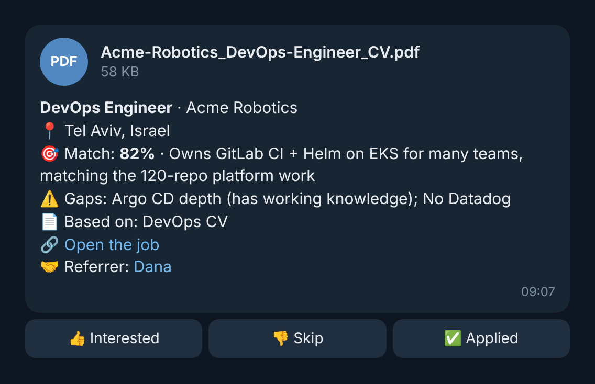
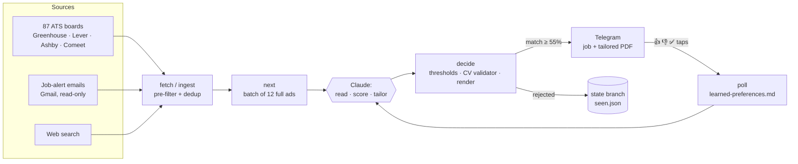

# Job Hunt Agent

[](../../actions/workflows/tests.yml)

An autonomous AI agent that hunts for jobs for me every hour. It pulls open positions from 80+ company career boards, job-alert emails and web search, scores each one against my real experience, writes a tailored one-page CV for every strong match, and sends the job plus the PDF to my Telegram. I tap 👍 / 👎 / ✅, and the agent learns from it.

It runs as a scheduled **[Claude Code](https://code.claude.com) cloud routine**. A deterministic Python CLI does everything that should be predictable. The model does only the parts that need judgment, and the CLI checks its work before anything leaves the system.

> **The CV in this repo is fictional.** "Jordan Avery" and the employers in `cv/` are made up so the project can be public. The code, tests, routine and design are the real ones from the version I run every day.

<p align="center">
  
</p>

## What a run does



1. **Read feedback.** `poll` collects button taps and "why did you skip it?" replies. Claude folds them into `learned-preferences.md` and applies them to every score in the run.
2. **Fetch.** `fetch` pulls every board in [`config/companies.yaml`](config/companies.yaml): about 5,800 jobs on a fresh run. A cheap regex pre-filter drops clear misses (wrong role family or seniority, outside central Israel, not full-time) before a single token is spent.
3. **Ingest.** Claude reads job-alert emails (LinkedIn, Glassdoor, Indeed and others) through a read-only Gmail connector and runs a few web searches, then hands the jobs to `ingest`. Every email or web job is swapped for the same posting on the company's own ATS board when one can be found (`resolve_official`).
4. **Decide, one batch at a time.** `next` hands out 12 candidates *with their full ads*. Claude reads each ad, scores it 0–100% against the master CV, picks a CV variant, tailors it, and writes a decision with a specific reason. `decide` refuses decisions on jobs that weren't in the batch, and vague reasons. The loop repeats until nothing is left.
5. **Send.** For each match, `decide` validates the tailored CV, renders it to a one-page PDF with Typst, and sends it to Telegram. The message carries the match rate, gaps, the official link and a referrer, if the company has one.
6. **Save state.** Everything decided is committed to an orphan `state` branch, so no job is ever sent twice.

## Design highlights

**Split the work between the model and the code.** The model reads ads, judges fit, tailors wording and names gaps. The code fetches, filters, dedups, enforces thresholds, validates, renders and delivers. Each decision the model makes passes through a CLI command that can reject it, so a bad judgment shows up as an error the agent has to fix rather than a message that reaches me. More in [DESIGN.md](DESIGN.md).

**A tailored CV can't lie.** Tailoring may reorder, emphasise and rephrase only what [`cv/master.yaml`](cv/master.yaml) and [`cv/skills-inventory.md`](cv/skills-inventory.md) support. Before every send, [`validate_tailored`](jobagent/cv.py) and `decide` enforce that mechanically. They reject:
- changed names, contact details, titles, employers, dates or education;
- any skill not in the master CV or the [skill policy](cv/skill-policy.yaml), and any skill marked never-claim;
- any number that appears in no source CV, so no invented "cut costs by 47%";
- a dropped required skill, a named personal project, or unescaped Typst markup;
- a CV longer than one page.

**Untrusted input, narrow tools.** Job ads, emails and web pages are treated as data, never instructions. Gmail is limited to three read-only tools. The only outbound channel is a CLI that can message one hard-coded Telegram chat, and updates from any other chat are ignored. The agent never applies for jobs, fills in forms or contacts anyone. The routine may push only to the `state` branch.

**Conservative dedup.** The same job arrives under different titles from different sources ("SR DevOps Engineer" from a LinkedIn email, "DevOps Engineer" on Workday). [`models.py`](jobagent/models.py) matches on posting ids extracted from URLs first (LinkedIn, Workday, Greenhouse, Lever, Ashby, Comeet), then on company plus title with filler words ignored. Seniority must match exactly. A missed duplicate costs one extra message, while a false match would hide a real job.

**Official links only.** Messages link the company's own careers page or ATS, never a job board. The CLI refuses to send an email or web job until the agent has either found the official posting or explicitly confirmed that it searched and found nothing.

**Lessons from live runs.** On an early run the agent read only about 11 of 59 ads and rejected 46 on title alone. Batching with full ads, plus the CLI refusing decisions outside the current batch, fixed it for good. Another run sent nothing because every "5+ years" ask was scored as a hard miss, so years became a soft signal capped at a few points. The [run log in DESIGN.md](DESIGN.md#lessons-from-live-runs) has the rest.

## Layout

| Path | What it is |
|---|---|
| [`ROUTINE.md`](ROUTINE.md), [`config/routine-prompt.md`](config/routine-prompt.md) | What the cloud agent does each run, and the prompt stored in the routine |
| [`jobagent/`](jobagent) | The deterministic CLI: `python -m jobagent --help` |
| [`cv/master.yaml`](cv/master.yaml), [`cv/skills-inventory.md`](cv/skills-inventory.md) | The only facts the agent may use (fictional here) |
| [`cv/variants/`](cv/variants) | Two approved CVs: DevOps/Platform/SRE and Software/Backend/Data |
| [`cv/skill-policy.yaml`](cv/skill-policy.yaml) | Which skills appear on every CV, per variant, or only when an ad asks |
| [`cv/template.typ`](cv/template.typ), [`cv/fonts/`](cv/fonts) | ATS-friendly Typst template, with bundled fonts so PDFs match everywhere |
| [`config/companies.yaml`](config/companies.yaml) | The career boards fetched every run |
| [`tests/`](tests) | 143 tests, including end-to-end runs through a dry-run Telegram client |
| [`examples/`](examples) | Rendered sample CVs and a sample message |
| [`CLAUDE.md`](CLAUDE.md) | Context for development sessions with Claude Code |

## Run it yourself

```bash
python -m pip install -r requirements-dev.txt
python -m pytest

# A dry run: messages and PDFs land in work/dry-run/ instead of Telegram.
python -m jobagent --state-dir work/dry-state --dry-run work/dry-run fetch
python -m jobagent --state-dir work/dry-state --dry-run work/dry-run next

# Render and validate CVs.
python -m jobagent render cv/variants/devops.yaml --out work/cv
python -m jobagent validate cv/variants/software.yaml software

# Find a company's public ATS board.
python -m jobagent discover "Company Name"
```

To use it for real:
1. Replace the files in `cv/` with your own CV, and adjust the areas and role families in [`jobagent/filters.py`](jobagent/filters.py).
2. Create a Telegram bot with @BotFather, send it `/start`, and run `python -m jobagent setup-telegram` to find your chat ID.
3. Create a Claude Code cloud environment with `TELEGRAM_BOT_TOKEN` and `TELEGRAM_CHAT_ID` set, and network access to `api.telegram.org` and the ATS hosts. Optionally set `JOBAGENT_REFERRER_SHEET` to the id of a public referral Google Sheet.
4. Create an orphan `state` branch, then a routine that runs [`config/routine-prompt.md`](config/routine-prompt.md) on a schedule, such as `7 5-21 * * *`. If you want email alerts, attach Gmail and limit it to `search_threads`, `get_thread` and `get_message`.

## Tech

Python 3.11+, Typst for PDF rendering, requests, PyYAML, openpyxl, pytest. Claude Code cloud routines with an MCP connector (Gmail). The Telegram Bot API for delivery and feedback.

## License

[MIT](LICENSE). Liberation Sans fonts: [SIL Open Font License](cv/fonts/LICENSE).
